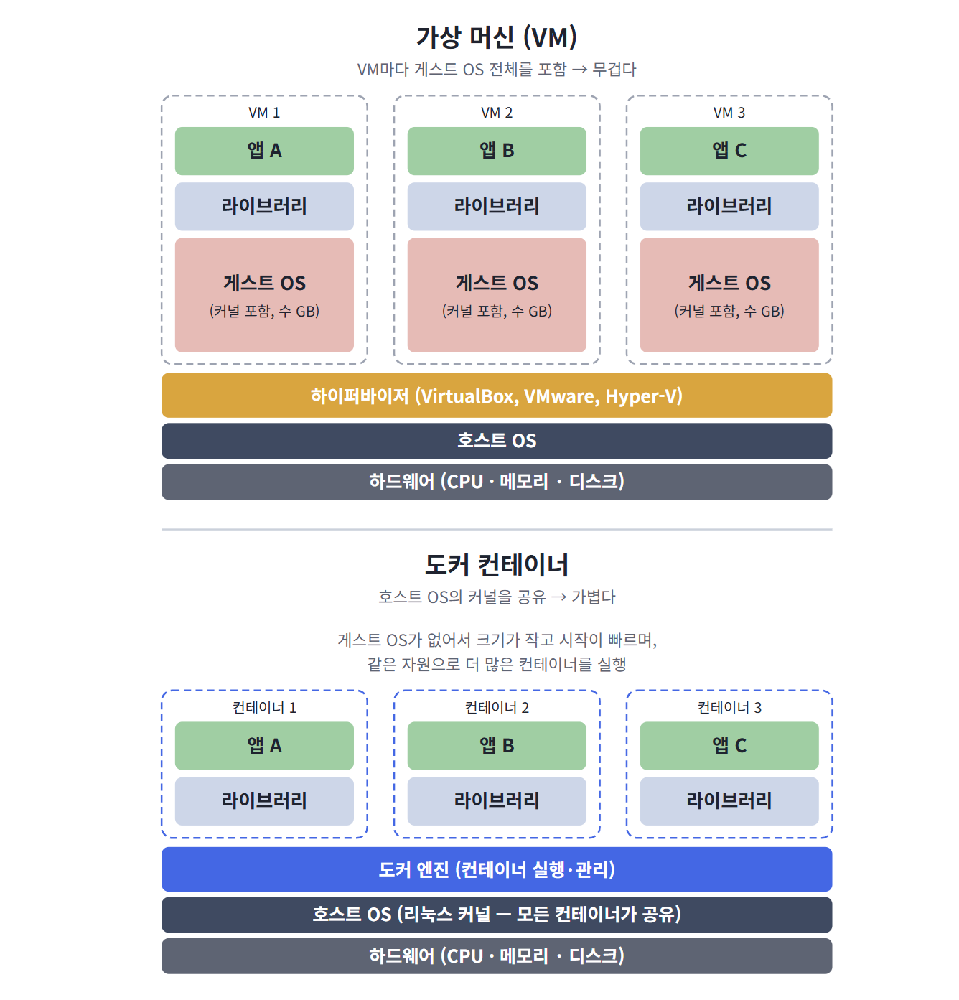
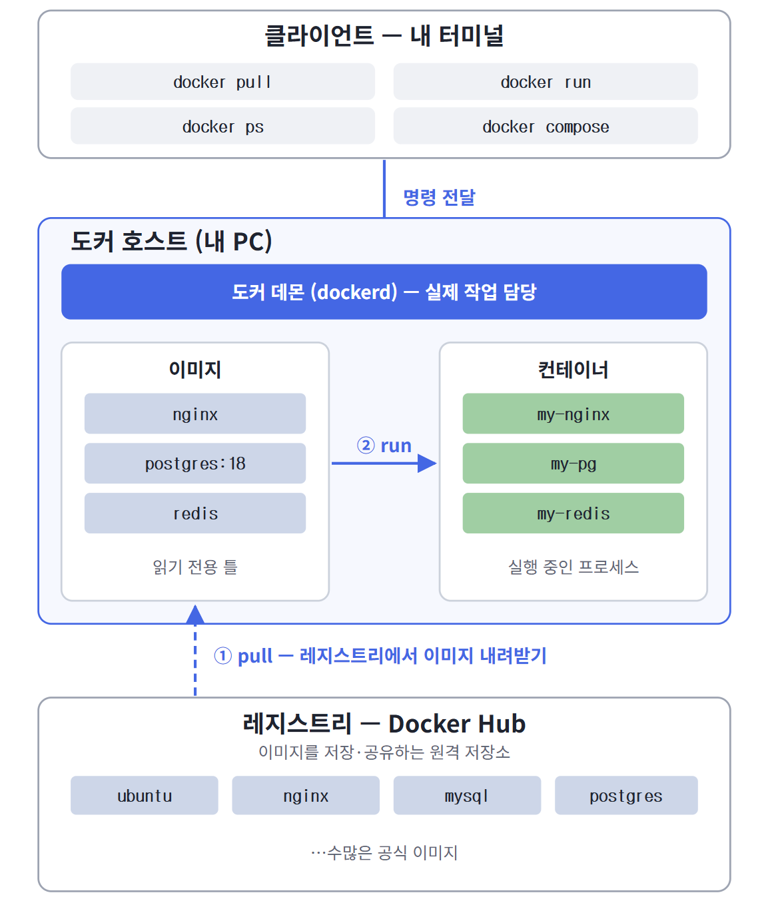
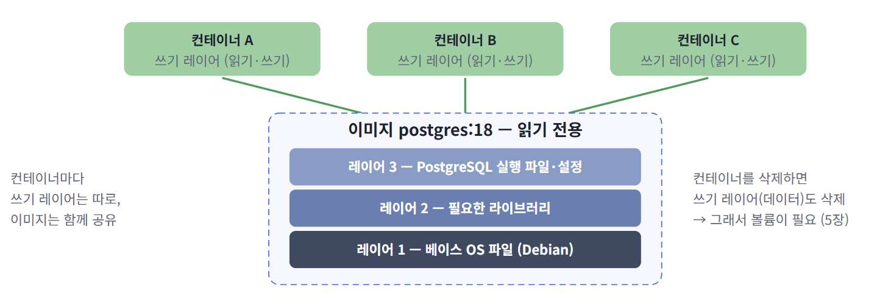

# 2026.11.12 TIL

## Docker 터미널 핸드온 실습

- Hello-world -> Unbuntu -> Nginx -> MySQL -> Redis -> PostgreSQL(볼륨) -> Docker COmpose 이미지 pull -> 컨테이너 실행
- -> 컨테이너 접속 -> 내부 실습 -> 정리 흐름을 서비스별로 반복합니다.

| 항목 | 내용 |
|---|---|
| 대상 | Docker를 처음 다뤄보는 개발자 |
| 환경 | Docker Desktop(Windows/macOS) 또는 Docker Engine(Linux) |
| 소요 시간 | 약 90~120분 |
| 사용 이미지 | `hello-world`, `ubuntu:24.04`, `nginx`, `mysql:8.4`, `redis`, `postgres:18` |

---
## 도커란? - 연혁과 핵심 개념
- 실습에 들어가기 전에 도커가 왜 나왔고, 무엇을 하는지 정리합니다.
- 왜 도커가 필요한가

> "제 PC에서는 잘 되는데요?"

- 개발자 PC,동료 PC,테스트 서버, 운영 서버마다 OS 버전, 설치된 라이브러리. 설정이 조금씩 다릅니다. 그래서 같은 코드가 어디서는 돌고 어디서는 안 돌곤 합니다.
- 도커는 애플리케이션과 실행에 필요한 모든 것(라이브러리, 설정, 런타임)을 하나의 "이미지"로 포장합니다. 그리고 어디서든 똑같은 "컨테이터"로 실행합니다.
- 화물을 규격 컨테이너에 담으면 배,기차,트럭 어디에 실어도 똑같이 다를 수 있는 것과 같습니다.
- 도커 로고의 고래가 컨테이너를 싣고 있는 이유입니다.

| 효과 | 설명 |
|---|---|
| 환경 일지 | 개발 테스트 운영 환경을 같은 이미지로 맞춤 |
| 빠른 설치 | MySQL, Redis 같은 서버를 설치 과정 없이 명령 한 줄로 실행 |
| 깔끔한 정리 | 컨테이너를 지우면 끝 -- 내 PC에 흔적이 남지 않음 |
| 가벼움 | VM보다 훨씬 작고 빠르게 실행 (아래 비교 참고) |

## 도커 연혁

| 시기 | 사건 |
|---|---|
| 2000년 | FreeBSD Jail, Solaris Zones 등 컨테이너 기술의 원형 등장 -- 도커가 컨테이너를 처음 발면한 것은 아님 |
| 2008 | 리눅스 커널 기능(namespaces, cgroups)을 활용한 LXC(Linux Containers)등장 |
| 2010 | Solomon Hykesr가 PaaS 기업 dotCloud 설립 - 배부 도구로 컨테이너 기술 개발 |
| 2013.3 | PyCon(미국 산타클라라)에서 도커 첫 공개, Apache 2.0 라이선스로 오픈소스 공개 |
| 2014.6 | Docker 1.0 출시 - 첫 안정 버전, DOcker Hub(이미지 저장소) 함께 공개 |
| 2015 | Docker Google CoreOS 등이 리눅스 재단 산하에 OCI(Open Container Initiative) 설립 - 이미지 런타임 표준화 |
| 2017 | 핵심 런타임 containerd를 CNCF에 기증, 오픈소스 프로젝트를 Moby로 분리 |
| 2020~ | Go로 다시 작성한 Composs v2 qkfvy - docker-compose -> docker compose로 통합 |
| 현재 |  컨테이너는 클라우드 쿠버네티스(Kubernnetes) 환경의 표준 배포 단위

## 가상 머신 (VM) vs 도커 컨테이너

| 비교  | 가상 머신 (VM) | 도커 컨테이너 |
|---|---|
| 가상화 대상 | 하드웨어 - 컴퓨터 한 대를 통째로 흉내 | 프로세스 - 격리된 프로그램 실행 |
| OS  | VM마다 게스트 OS(커널 포함) 설치 | 호스트 OS의 커널을 공유 |
| 크기 | 수 GB | 수 MB ~ 수백 MB |
| 시작 시간 | 수십초~ 수 분 (OS 부팅) | 1초 안팎(프로세스 시작) |
| 격리 수준 | 강함 (OS 단위로 완전히 분리) | 상대적으로 약함 (커널 공유) |
| 핵심 기술 | 하이퍼바이저 | 리눅스 커널의 namespaces(격리) + cgroups(자원 제한) |
| 비유 | 아파트 단지에 단독주택을 여러 체 짓기 | 한 건물 안에 원룸을 여러개 나누기 |

> 📌 컨테이너는 "가벼운 VM"이 아니라 "격리된 프로세스"입니다. 컨테이너 안에서는 자신만의 파일 시스템, 네트워크, 프로세스 목록이 보이지만, 실제로는 호스트 커널 위에서 도는 평범한 프로세스입니다. 그래서 OS 부팅이 없고 빠릅니다.

> 💡 Windows·macOS에서는? 컨테이너는 리눅스 커널이 필요합니다. 그래서 Docker Desktop은 내부에 작은 리눅스 VM(Windows는 WSL 2)을 하나 띄우고, 그 안에서 컨테이너를 실행합니다. VM 한 개 위에 컨테이너 여러 개가 올라가는 구조입니다.

## 도커의 구성 — 클라이언트 · 데몬 · 레지스트리

| 구성 요소 | 역할 |
|---|---|
| 클라이언트 (docker 명령) | 사용자가 입력한 명령을 데몬에 전달 |
| 도커 데몬 (dockerd) | 이미지 다운로드, 컨테이너 생성 실행 삭제 등 실젝 작업 수행  - daemon :백그라운드에서 계속 실행되는 프로그램 |
| 레지스트리 (Docker Hub) | 이미지를 저장하고 고유하는 원격 저장소 registry 등록소 |

> 📌 docker run을 할 때 이미지가 내 PC에 없으면 데몬이 자동으로 pull 합니다. 이 실습에서는 흐름을 익히려고 pull을 먼저 따로 실행합니다.

## 이미지 (Image)

- 이미지는 컨테이너를 만들기 위한 읽기 전용 "틀(템플릿)" 입니다. 앱을 실행하는 데 필요한 파일 시스템(최소한의 OS 파일, 라이브러리, 실행 파일, 설정)과 "시작하면 무엇을 실행할지" 같은 정보가 들어 있습니다.

| 특징 | 설명 |
|---|---|
| 읽기 전용 | 한 번 만들어진 이미지는 바뀌지 않음 |
| 레이어 구조 |	여러 겹의 레이어를 쌓아 만듦 — 같은 레이어는 이미지끼리 공유하고, 이미 받은 레이어는 다시 받지 않음 |
| 이름:태그 | postgres:18, ubuntu:24.04처럼 이름:태그로 구분. 태그를 생략하면 latest |
| 저장 위치 | 레지스트리(Docker Hub)에서 pull로 받아 내 PC에 저장 → docker images로 확인 |

> 💡 docker pull 출력에서 줄마다 Pull complete가 찍히는 것이 바로 레이어 하나하나를 받는 과정입니다. 이미 받은 레이어는 Already exists로 표시됩니다.

## 컨테이너 (Container)

- 컨테이너는 이미지를 실행한 것(실행 인스턴스) 입니다. 이미지 위에 쓰기 가능한 얇은 레이어를 한 장 덧붙이고, 격리된 프로세스로 실행합니다.

| 특징 | 설명 |
|---|---|
| 이미지의 실행 인스턴스 | 이미지 하나로 컨테이너 여러 개를 만들 수 있음 (서로 격리) |
| 격리된 프로세스 |	자신만의 파일 시스템·네트워크·프로세스 공간을 가짐 |
| 쓰기 레이어 | 컨테이너 안에서 만든 파일·데이터는 이 레이어에 저장 → 컨테이너 삭제 시 함께 사라짐 |
| 생명주기 | 생성 → 실행 → 정지 → 삭제 (아래 그림) |